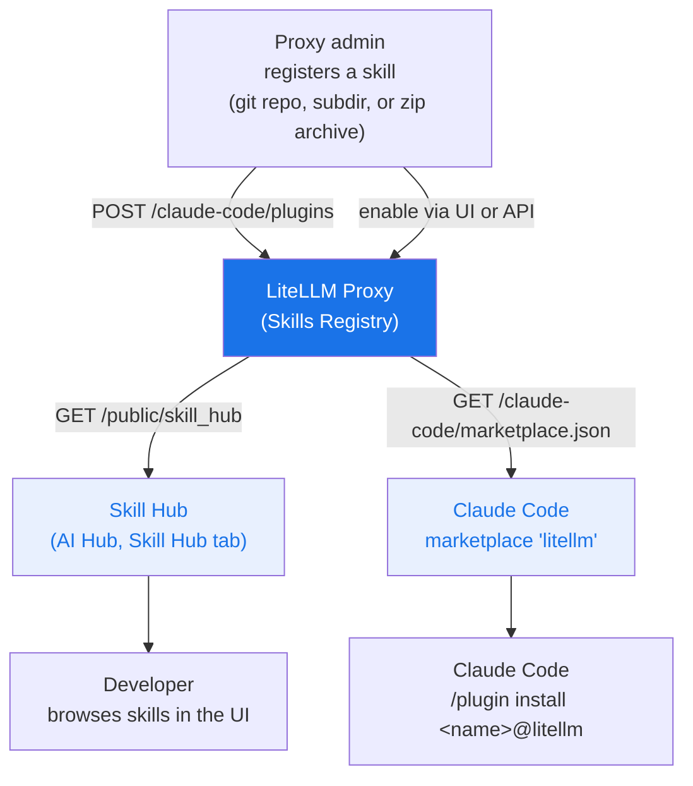

# Skills Gateway

<iframe width="840" height="500" src="https://www.loom.com/embed/cb74eb79df3e4c2b83a6efae54a589f9" frameBorder="0" allowFullScreen></iframe>

Use LiteLLM Skills Hub to upload, import, discover, and download [Agent Skills](https://agentskills.io/specification) packages for Codex, Claude Code, and other compatible agents. The neutral `/skill-hub/skills` API shares the existing registry and access grants with the Claude Code marketplace.

## Portable Agent Skills API

You need a connected database and a proxy admin key to upload or import a skill. Upload a ZIP containing `SKILL.md` at its root or inside one top-level folder. Include supporting files such as `scripts/`, `references/`, `assets/`, and `agents/openai.yaml`; the portable download preserves their bytes and executable script permissions.

`SKILL.md` must declare a name and description in YAML frontmatter. Hub names use the existing ASCII registry policy: 1–64 lowercase letters, digits, and single hyphens between segments (`^[a-z0-9]+(?:-[a-z0-9]+)*$`). Unicode names are not supported. Descriptions must contain 1–1024 characters.

### Upload or import

A portable package can contain:

```text
pdf-summarizer/
  SKILL.md
  scripts/extract.sh
  agents/openai.yaml
```

For example, `SKILL.md` can contain:

```markdown
---
name: pdf-summarizer
description: Summarize PDFs with page citations.
---
Read the PDF and cite page numbers in the summary.
```

```bash
zip -r pdf-summarizer.zip pdf-summarizer
curl --fail-with-body https://your-proxy/skill-hub/skills/upload \
  -H "Authorization: Bearer $LITELLM_MASTER_KEY" \
  -F "file=@pdf-summarizer.zip" \
  -F "version=1.0.0"
```

Import a public skill from skills.sh:

```bash
curl --fail-with-body https://your-proxy/skill-hub/skills/import \
  -H "Authorization: Bearer $LITELLM_MASTER_KEY" \
  -H "Content-Type: application/json" \
  -d '{"url":"https://skills.sh/vercel-labs/agent-skills/vercel-react-best-practices"}'
```

Imports accept HTTPS `skills.sh/<owner>/<repository>/<skill>` and `github.com/<owner>/<repository>` URLs. For a GitHub repository, select exactly one skill with `skill` or the repository-relative `path`. Use `ref` for a commit, tag, or branch; it defaults to `HEAD`. A GitHub tree URL can supply the ref and directory instead. LiteLLM stores a snapshot of the selected directory. An unrelated repository symlink, such as a root `CLAUDE.md`, does not block the import. Symlinks inside the selected skill are rejected. Private repositories, SSH URLs, other hosts, and arbitrary archive URLs are not supported by this import endpoint.

Upload ZIPs and downloaded repository ZIPs are limited to 10 MiB. The archive must contain at most 1,000 entries and 50 MiB of unpacked data. Whole-ZIP path validation and size limits include files outside the selected skill. Existing names return `409`; import and upload do not overwrite an existing package.

New uploads and imports create public registry entries. Use `POST /skill-hub/skills/{name}/unpublish` to keep a skill private and retain its explicit grants. Public CLI discovery also requires the opt-in setting below.

### Browse and download

Use a LiteLLM key to list public skills and private skills granted to that key or its team:

```bash
curl --fail-with-body 'https://your-proxy/skill-hub/skills?query=pdf&offset=0&limit=20' \
  -H "Authorization: Bearer $LITELLM_API_KEY"

curl --fail-with-body https://your-proxy/skill-hub/skills/pdf-summarizer/content \
  -H "Authorization: Bearer $LITELLM_API_KEY"

curl --fail-with-body https://your-proxy/skill-hub/skills/pdf-summarizer/archive \
  -H "Authorization: Bearer $LITELLM_API_KEY" \
  -o pdf-summarizer.zip
```

The list response contains `skills`, `count`, and `next_offset`. Each managed package provides `download_url` and `content_url`. Entries that point to external sources can appear in the shared catalog without those URLs. The content route returns the original `SKILL.md`; the archive route includes its supporting files with `SKILL.md` at the ZIP root. These routes also serve existing managed Claude uploads that contain a valid Agent Skill. External Git or URL registrations keep their original sources.

| Endpoint | Auth | Purpose |
|----------|------|---------|
| `POST /skill-hub/skills/upload` | Proxy admin | Upload a portable ZIP; optional form field `version` |
| `POST /skill-hub/skills/import` | Proxy admin | Snapshot a public GitHub or skills.sh skill |
| `GET /skill-hub/skills` | LiteLLM key | Search visible skills with `query`, `offset`, and `limit` (1–100) |
| `GET /skill-hub/skills/{name}` | LiteLLM key | Read visible skill metadata and download URLs |
| `GET /skill-hub/skills/{name}/content` | LiteLLM key, or eligible public access | Read the original `SKILL.md` |
| `GET /skill-hub/skills/{name}/archive` | LiteLLM key, or eligible public access | Download the portable ZIP |
| `PUT /skill-hub/skills/{name}` | Proxy admin | Replace public metadata while preserving the archive and Claude adapter settings |
| `POST /skill-hub/skills/{name}/publish` | Proxy admin | Make the registry entry public |
| `POST /skill-hub/skills/{name}/unpublish` | Proxy admin | Hide it from public discovery while retaining grants |
| `DELETE /skill-hub/skills/{name}` | Proxy admin | Delete the skill and managed archive |

`PUT` accepts `description`, `version`, `domain`, `namespace`, and `keywords`. Omitted fields in that set clear. The stored package, source, and Claude adapter settings such as `installation_preference` remain unchanged.

Anonymous content and archive requests require a public skill, `litellm_settings.public_skills_index: true`, and marketplace authentication disabled. Authenticated downloads remain available when the public index is off. Private skills use the existing [key and team grants](#private-skills).

## Claude Code marketplace {#how-it-works}



Enabled skills are public: they appear in the Skill Hub and in `marketplace.json` for anyone who can reach the proxy. Disabled skills are private and only reach keys or teams that were granted them (see [Private skills](#private-skills)). New skills are enabled as soon as they are registered, so disable one to keep it private. Only proxy admins can create, update, enable, disable, or delete skills; any other key is rejected with a `401` or `403`.

## Quick start

### 1. Register a skill

In the Admin UI open **Skills**, click **+ Add Skill**, and paste a GitHub URL, a git clone URL (HTTPS or SSH), or an HTTPS link to a zip file. LiteLLM detects the source type and suggests a skill name, including for skills nested in a subdirectory such as `github.com/org/repo/tree/main/skills/my-skill`.

Or register it through the API with an admin key:

```bash
curl -X POST https://your-proxy/claude-code/plugins \
  -H "Authorization: Bearer $LITELLM_MASTER_KEY" \
  -H "Content-Type: application/json" \
  -d '{
    "name": "grill-me",
    "source": {
      "source": "git-subdir",
      "url": "https://github.com/mattpocock/skills",
      "path": "skills/productivity/grill-me"
    },
    "description": "Interview skill for relentless questioning",
    "domain": "Productivity",
    "namespace": "interviews"
  }'
```

`POST` only creates. Registering a name that already exists returns `409`; change an existing skill with `PUT /claude-code/plugins/{name}` instead.

### 2. Publish or unpublish

A newly registered skill is already enabled and public. To change which skills are public, use the Admin UI: **AI Hub → Skill Hub → Select Skills to Make Public**.

Or the API, with `/disable` to unpublish and `/enable` to publish again:

```bash
curl -X POST https://your-proxy/claude-code/plugins/grill-me/disable \
  -H "Authorization: Bearer $LITELLM_MASTER_KEY"
```

### 3. Browse the hub

Public skills appear in the Admin UI under **AI Hub → Skill Hub**, on the public page at `/ui/model_hub` under the **Skill Hub** tab (no login required), and through the API at `GET /public/skill_hub`.

### 4. Install in Claude Code

Add the proxy marketplace once. The marketplace is always named `litellm`:

```
/plugin marketplace add https://your-proxy/claude-code/marketplace.json
```

Then install any skill by `<name>@litellm`:

```
/plugin install grill-me@litellm
```

The same commands work from a shell as `claude plugin marketplace add <url>` and `claude plugin install grill-me@litellm`.

To roll the marketplace out through settings instead, add it to `extraKnownMarketplaces`. The `source` value is an object; a flat `"source": "url"` entry is rejected by Claude Code as an invalid marketplace entry and ignored:

```json title="~/.claude/settings.json"
{
  "extraKnownMarketplaces": {
    "litellm": {
      "source": {
        "source": "url",
        "url": "https://your-proxy/claude-code/marketplace.json"
      }
    }
  }
}
```

## Private skills

A disabled skill stays out of the Skill Hub and the anonymous `marketplace.json`, but you can grant it to specific keys or teams through `object_permission.skills`. In the Admin UI use **Allowed Skills** when creating or editing a key or team. Through the API:

```bash
curl -X POST https://your-proxy/key/generate \
  -H "Authorization: Bearer $LITELLM_MASTER_KEY" \
  -H "Content-Type: application/json" \
  -d '{"object_permission": {"skills": ["internal-runbook"]}}'
```

When both the key and its team list skills, the key gets the intersection of the two lists; otherwise it gets whichever list is set. Developers add the key to the marketplace URL so their granted skills show up next to the public ones:

```
/plugin marketplace add "https://your-proxy/claude-code/marketplace.json?key=sk-..."
```

`GET /claude-code/plugins` and `GET /claude-code/plugins/{name}` apply the same rule: a non-admin key sees enabled skills plus the ones granted to it, and gets a `403` for a disabled skill it was not granted. Proxy admins see everything.

## Skill fields

| Field | Description |
|-------|-------------|
| `name` | Unique kebab-case identifier (`^[a-z0-9-]+$`), used in `/plugin install <name>@litellm`. Set on create and fixed afterwards |
| `source` | Where Claude Code fetches the skill from; see [Source formats](#source-formats) |
| `description` | Short description shown in the hub |
| `domain` | Top-level grouping in the Skill Hub (e.g. `Engineering`, `Productivity`) |
| `namespace` | Sub-grouping within a domain (e.g. `quality`, `meetings`) |
| `category` | Category shown in the marketplace |
| `keywords` | Tags for search and filtering |
| `version` | Semver string; defaults to `1.0.0` on create |
| `installation_preference` | <SinceVersion v="1.107.0" /> Optional `available`, `auto_install`, or `required`, served as `installationPreference` for [Claude Desktop auto-install](./tutorials/claude_code_plugin_marketplace.md#auto-install-plugins-in-claude-desktop). Needs an `archive` source, and `auto_install` and `required` also need its `sha256`. Claude Desktop treats a per-plugin `required` like `auto_install`, so users can still remove it |
| `author` | `{"name": "...", "email": "..."}` |
| `homepage` | Homepage URL |

## Source formats

| `source.source` | Required fields | Example |
|-----------------|-----------------|---------|
| `github` | `repo` | `{"source": "github", "repo": "org/repo"}` |
| `url` | `url` | `{"source": "url", "url": "https://gitlab.com/org/repo.git"}` |
| `git-subdir` | `url`, `path` | `{"source": "git-subdir", "url": "https://github.com/org/repo.git", "path": "skills/my-skill"}` |
| `archive` | `url` (HTTPS), optional `sha256` | `{"source": "archive", "url": "https://bucket.s3.amazonaws.com/my-skill.zip", "sha256": "<64 hex chars>"}` |

`git-subdir` paths must be relative slash-separated segments of letters, digits, dots, hyphens, and underscores. `archive` URLs must use HTTPS, and `sha256`, when present, must be a 64-character hex digest. Claude Code downloads from these sources on the developer's machine, so private repositories and archives need credentials there.

## API reference

| Endpoint | Auth | Description |
|----------|------|-------------|
| `POST /claude-code/plugins` | Proxy admin | Create a skill (`409` if the name exists) |
| `GET /claude-code/plugins` | Any key | List the skills visible to the caller. `?enabled_only=true` returns only public skills |
| `GET /claude-code/plugins/{name}` | Any key | Get one skill (`403` if it is disabled and not granted to the caller) |
| `PUT /claude-code/plugins/{name}` | Proxy admin | Replace a skill. Omitted fields reset to their defaults, and `version` and `installation_preference` are cleared if omitted |
| `POST /claude-code/plugins/{name}/enable` | Proxy admin | Publish a skill |
| `POST /claude-code/plugins/{name}/disable` | Proxy admin | Unpublish a skill |
| `DELETE /claude-code/plugins/{name}` | Proxy admin | Delete a skill |
| `GET /public/skill_hub` | None | List public skills |
| `GET /claude-code/marketplace.json` | None, or `?key=` | Claude Code marketplace manifest. `?key=` adds the disabled skills granted to that key |

## Agent Skills discovery index

The Hub contributes public packages created through `/skill-hub/skills/upload` or `/skill-hub/skills/import`. Existing managed Claude uploads can use neutral downloads when valid, but do not automatically appear in this index.

The index also retains skills uploaded to the proxy's own store through [`/v1/skills`](./skills.md) with `custom_llm_provider=litellm_proxy`. That provider-compatible API and its storage remain separate from the Hub API. The combined index contains at most 1,000 skills, with hosted-store entries retaining priority. Name collisions receive unique installation aliases, while the original `SKILL.md` remains unchanged.

The index is off by default. Enabling it exposes installable skills from the hosted `/v1/skills` store to anyone who can reach the proxy, alongside eligible public Hub packages:

```yaml title="config.yaml"
litellm_settings:
  public_skills_index: true
```

The index is available at `GET /.well-known/agent-skills/index.json`, with `/.well-known/skills/index.json` as an alias. Hosted-store archives retain `GET /v1/skills/{skill_id}/archive`; Hub entries use `GET /skill-hub/skills/{name}/archive`. The two index routes and the hosted-store archive route return `404` while `public_skills_index` is off.

Hub packages appear in the anonymous index only when they are public and `general_settings.claude_code_marketplace_auth_required` is not enabled. That authentication setting does not change the existing hosted-store publication behavior.

### Install in Codex and Claude Code

From your project directory, use Node.js 22.20.0 or newer and the pinned [skills CLI 1.7.6](https://www.npmjs.com/package/skills/v/1.7.6):

```bash
npx --yes skills@1.7.6 add https://your-proxy \
  --skill pdf-summarizer --agent codex claude-code --copy --yes
```

Replace `pdf-summarizer` with a skill name in your public index. The CLI installs the package for both selected agents. Use `--list` instead of the selection and installation flags to inspect the available skills.

The [pinned CLI's well-known provider](https://github.com/vercel-labs/skills/blob/7a5e920bead4b1039a6d6df5d7e1163b7b09423a/src/providers/wellknown.ts) sends no LiteLLM authentication headers when it fetches the index or archive URLs. This installation flow therefore requires anonymous access to the selected package. For private skills, download the archive with an authorized key through the neutral API above. The Claude marketplace's `?key=` flow remains separate.
